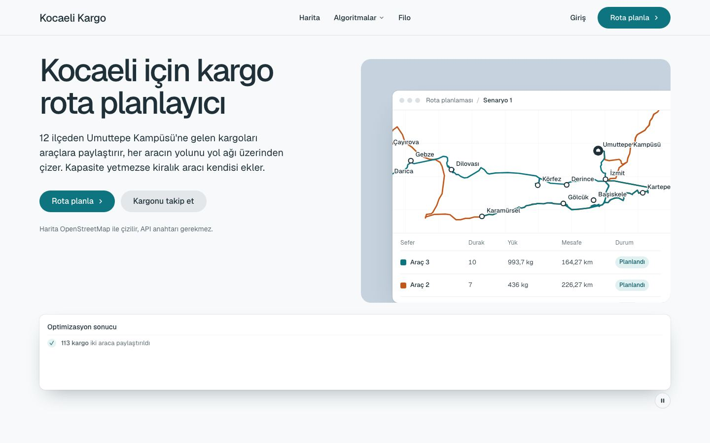
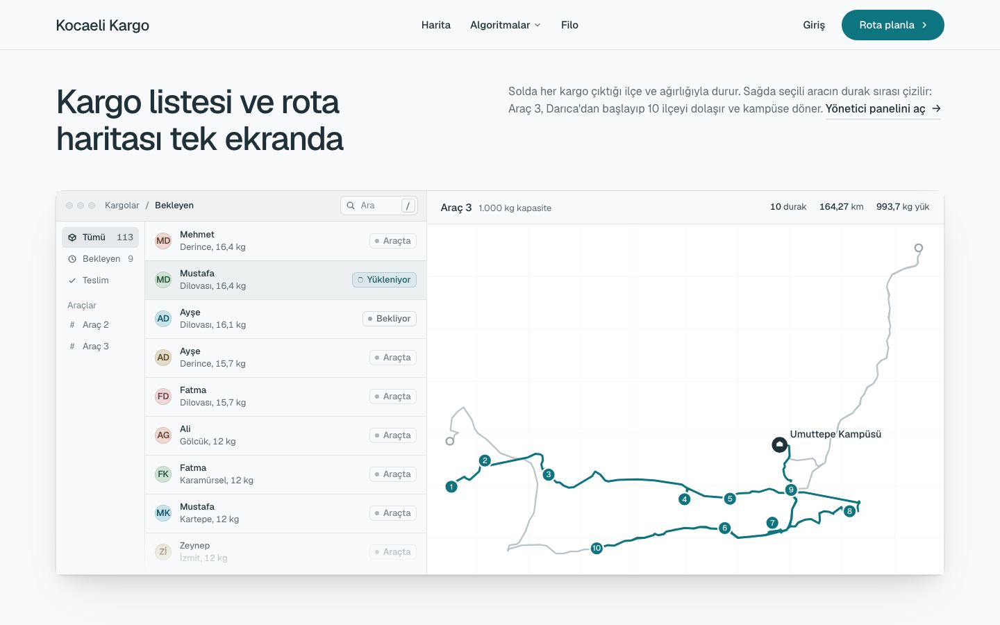
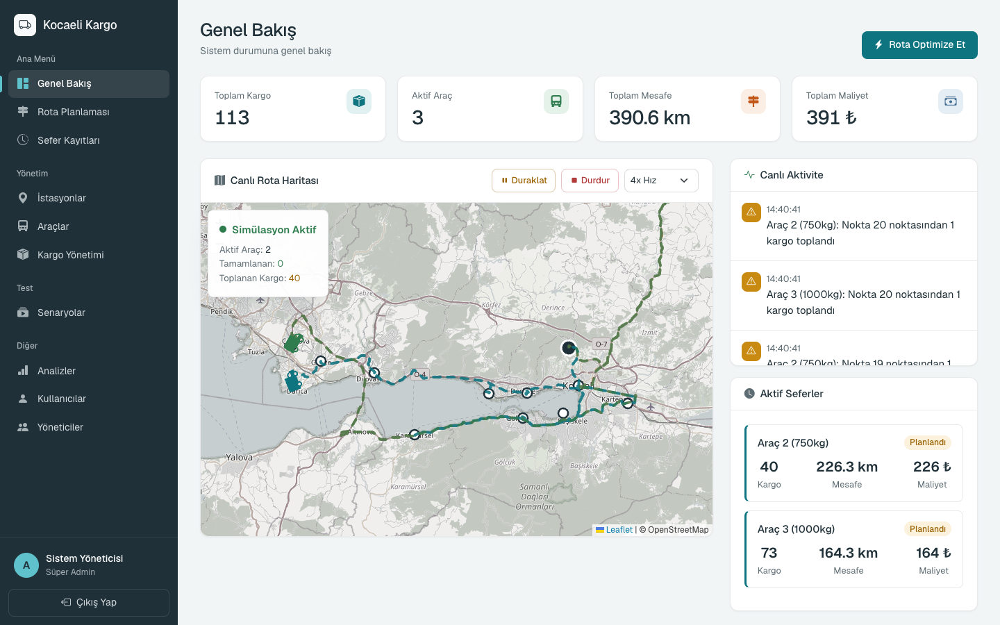
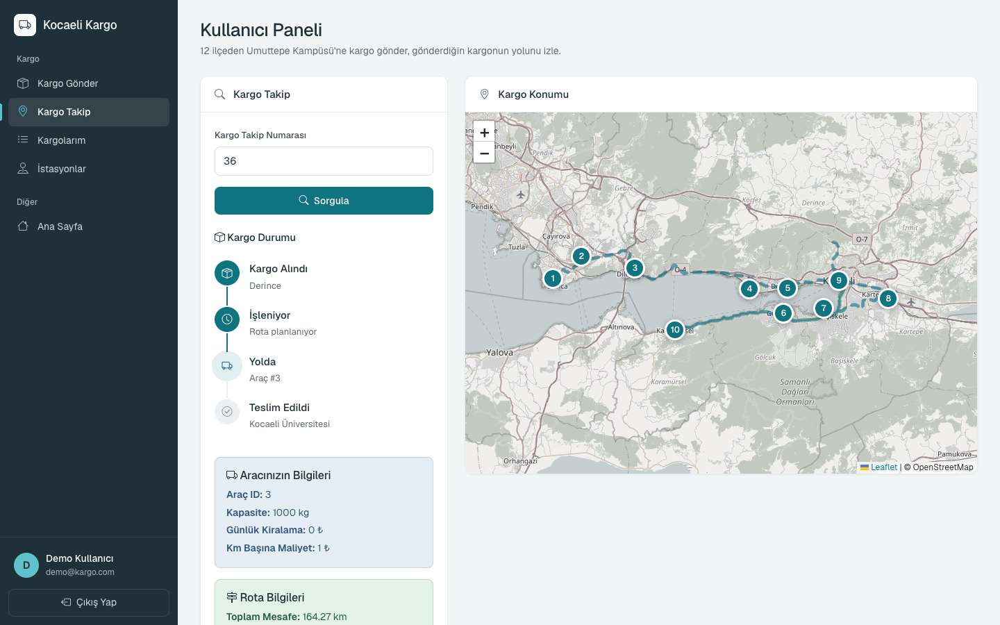
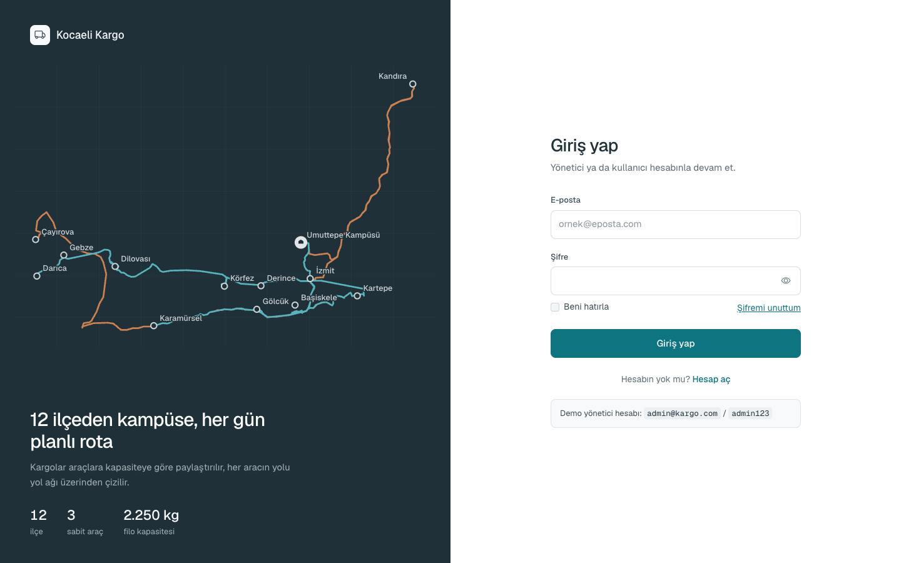

# Kocaeli Üniversitesi Kargo Dağıtım Sistemi

Kocaeli'nin 12 ilçesinden Kocaeli Üniversitesi'ne (Umuttepe Kampüsü) kargo
taşımacılığı için yük ve rota planlaması yapan, **Clarke-Wright** ve
**genetik algoritma** tabanlı bir optimizasyon sistemi. Flask ile geliştirildi.

## Ekran görüntüleri

Ana sayfa: Senaryo 1'in gerçek optimizasyon çıktısı (113 kargo, 2 araç, 390,55 km):



Kargo listesi ve seçili aracın numaralı durak sırası:



Yönetici paneli, sefer simülasyonu çalışırken:



Kullanıcı paneli, kargo takibi:





## Özellikler

- **Clarke-Wright Savings** ile rota planlama (`/api/routes/optimize`)
- **Genetik algoritma (GA)** ile dört senaryonun karşılaştırılması (`/api/scenarios/compare-all`)
- **Dijkstra** ile 13 düğümlü Kocaeli yol ağında en kısa yol (kuş uçuşu değil)
- **OSRM** ile haritada gerçek yol geometrisi (internet bağlantısı gerekir)
- **Leaflet.js + OpenStreetMap** ile interaktif harita (harici API anahtarı gerekmez)
- Kullanıcı ve yönetici panelleri, kullanıcı yalnızca kendi kargosunun güzergahını görür
- Kapasite aşımında otomatik kiralık araç desteği
- 4 farklı test senaryosu ve anlık sefer kaydı

## Algoritmalar

| Algoritma | Kullanım | Parametreler |
|---|---|---|
| **Clarke-Wright** | Ana rota planlama | `s(i,j) = d(depo,i) + d(depo,j) − d(i,j)`, kapasite ve bölge kısıtlı |
| **Genetik Algoritma** | Senaryo karşılaştırma | Popülasyon 150 · 300 nesil · mutasyon 0,15 · çaprazlama 0,85 · 15 seçkin |
| **Dijkstra** | İlçeler arası yol | 13 düğümlü yol ağı, önceden hesaplanmış en kısa yollar |

> `algorithms/genetic_algorithm.py` içinde bir `KnapsackOptimizer` sınıfı var ama şu an
> hiçbir uç noktaya bağlı değil.

## Kurulum

```bash
# 1) Depoyu klonlayın
git clone https://github.com/selimdogann/kargo-rota-optimizasyonu.git
cd kargo-rota-optimizasyonu

# 2) Sanal ortam (Python 3.12 ile test edildi)
python3 -m venv .venv
source .venv/bin/activate          # Windows: .venv\Scripts\activate

# 3) Bağımlılıklar
pip install -r requirements.txt

# 4) Veritabanını oluşturun
python init_db.py

# 5) Çalıştırın (varsayılan port 5055)
python app.py

# Geliştirirken: otomatik yeniden yükleme ve farklı port
FLASK_DEBUG=1 PORT=5060 python app.py
```

Ardından tarayıcıda:

- Ana sayfa: <http://localhost:5055>
- Kullanıcı paneli: <http://localhost:5055/user>
- Yönetici paneli: <http://localhost:5055/admin>

> Port, macOS'ta AirPlay'in kullandığı 5000 ile çakışmasın diye 5055'tir;
> `PORT` ortam değişkeniyle değiştirilebilir.

Örnek yönetici girişi: `admin@kargo.com` / `admin123` (yalnızca demo verisi).

## İstasyonlar

Depo **Kocaeli Üniversitesi**, teslimat noktaları 12 Kocaeli ilçesidir:

| İstasyon | Tip | Koordinat |
|---|---|---|
| **Kocaeli Üniversitesi** | Ana depo | 40.8225, 29.9213 |
| İzmit | İlçe | 40.7656, 29.9406 |
| Gebze | İlçe | 40.8027, 29.4307 |
| Darıca | İlçe | 40.7694, 29.3753 |
| Çayırova | İlçe | 40.8267, 29.3728 |
| Dilovası | İlçe | 40.7847, 29.5369 |
| Körfez | İlçe | 40.7539, 29.7636 |
| Derince | İlçe | 40.7544, 29.8389 |
| Gölcük | İlçe | 40.7175, 29.8306 |
| Karamürsel | İlçe | 40.6917, 29.6167 |
| Başiskele | İlçe | 40.7244, 29.9097 |
| Kandıra | İlçe | 41.0706, 30.1528 |
| Kartepe | İlçe | 40.7389, 30.0378 |

## Araç filosu

| Araç | Kapasite | Maliyet |
|---|---|---|
| Araç 1 | 500 kg | 1.0 ₺/km |
| Araç 2 | 750 kg | 1.0 ₺/km |
| Araç 3 | 1000 kg | 1.0 ₺/km |
| Kiralık | 500 / 750 / 1000 kg | 200 / 250 / 300 ₺ günlük + km başına 1,0 / 1,2 / 1,5 ₺ |

Toplam sabit kapasite: **2250 kg**; aşımda, aşım miktarına göre tek bir kiralık araç eklenir.

## Test senaryoları

1. **Dengeli dağılım (1445 kg, 113 kargo, 12 ilçe)**: kiralama gerekmez
2. **Batı ilçeleri ağırlıklı (1105 kg, 118 kargo, 6 ilçe)**: kiralama gerekmez
3. **Ağır kargolar (2700 kg, 17 kargo, 4 ilçe)**: kiralık araç gerekli
4. **Doğu ilçeleri ağırlıklı (1550 kg, 88 kargo, 6 ilçe)**: kiralama gerekmez

## API

| Uç nokta | Açıklama |
|---|---|
| `GET/POST/DELETE /api/stations` | İstasyon listele / ekle / sil |
| `GET/POST /api/cargos`, `GET /api/cargos/track/<no>` | Kargo yönetimi ve takip |
| `GET/POST /api/vehicles` | Araç yönetimi |
| `POST /api/routes/optimize`, `GET /api/routes/active` | Rota optimizasyonu ve aktif rotalar |
| `POST /api/scenarios/load/<id>` | Test senaryosu yükle |
| `GET /api/analytics/summary` | Özet istatistikler |

## Arayüz

- Tek tasarım sistemi: açık zemin, petrol-teal vurgu (`#0d7480`), teslimat turuncusu
  (`#c2571a`), Geist yazı ailesi.
- `static/css/app.css`: yönetici, kullanıcı ve giriş sayfalarının ortak stili (Bootstrap 5 üzerine).
- `static/css/landing.css` + `static/assets/`: ana sayfa; yerleşim ve hareket katmanı
  `static/assets` altındaki hazır CSS/JS kitinden gelir.
- Ana sayfadaki ve giriş ekranındaki harita, optimizasyonun gerçek OSRM çıktısından üretilmiş
  bir SVG'dir (`templates/partials/route_map*.svg`).

## Proje yapısı

```
kargo-rota-optimizasyonu/
├── app.py                       # Ana Flask uygulaması
├── init_db.py                   # Veritabanı başlatma
├── requirements.txt
├── algorithms/
│   ├── clarke_wright.py         # Clarke-Wright Savings + OSRM
│   ├── genetic_algorithm.py     # GA (+ kullanılmayan Knapsack sınıfı)
│   ├── distance_calculator.py   # Yol ağı ve Dijkstra
│   └── scenarios.py             # Test senaryoları
├── templates/
│   ├── index.html               # Ana sayfa
│   ├── auth_base.html           # Giriş/kayıt sayfalarının ortak iskeleti
│   ├── login.html, register.html, forgot_password.html, reset_password.html
│   ├── admin_panel.html, user_panel.html
│   └── partials/                # Rota haritası SVG'leri
└── static/
    ├── css/app.css, css/landing.css
    └── assets/                  # Ana sayfa yerleşim ve hareket kiti
```

## Lisans

MIT — bkz. [LICENSE](LICENSE).

## Geliştirici

**Selim Doğan** — Kocaeli Üniversitesi, Bilgisayar Mühendisliği (Yazılım Laboratuvarı projesi)
